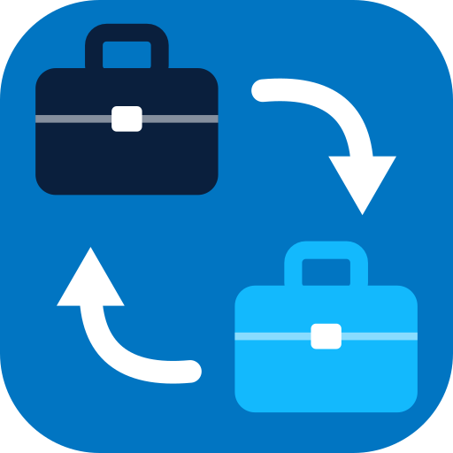

# deceiver_flutter

A Flutter debug control panel for the
[Deceiver](https://pub.dev/packages/deceiver) HTTP mocking library.

Toggle mocks on/off at runtime, switch between strict and passthrough
modes, and manage individual mock registrations -- all from a Material
UI panel you can embed anywhere in your app.

## Features

- **Global toggle** -- enable/disable all mocks with a single switch
- **Strict mode toggle** -- switch `onlyAllowMocks` on/off at runtime
- **Scenarios** -- switch between named scenarios and toggle their mocks
- **Per-mock toggles** -- enable/disable individual mock registrations
- **Mock list** -- see all registered mocks with their descriptions and status
- **Reactive** -- panel updates automatically when settings change, also
  when they change directly on the `Deceiver` or from the Deceiver
  DevTools extension
- **Material Design** -- built with
  [`material_ui`](https://pub.dev/packages/material_ui) and follows your
  app's theme

## Installation

Requires Flutter 3.47 or later.

The panel lives in your app code (`lib/`), so add both packages as regular
dependencies, not as dev dependencies:

```sh
flutter pub add deceiver deceiver_flutter
```

Only show the panel and use the `DeceiverClient` in debug builds (for
example behind `kDebugMode`), so the mocks never end up active in a
release build.

The panel uses `package:material_ui`. In apps that still use
`package:flutter/material.dart` it works as well, but it shows Material's
default theme instead of your app's theme.

## Quick Start

```dart
import 'package:deceiver/deceiver.dart';
import 'package:deceiver_flutter/deceiver_flutter.dart';
import 'package:material_ui/material_ui.dart';

// 1. Create a Deceiver instance and register mocks.
final deceiver = Deceiver();
// ... register mocks ...

// 2. Wrap it in a DeceiverController.
final controller = DeceiverController(deceiver);

// 3. Drop the panel into your widget tree.
Scaffold(
  appBar: AppBar(title: Text('Debug Panel')),
  body: DeceiverPanel(controller: controller),
);
```

## Usage

### Setting up the controller

`DeceiverController` is a `ChangeNotifier` that wraps a `Deceiver`
instance. It provides reactive getters and setters so the panel (and
any other listener) rebuilds when settings change.

```dart
final deceiver = Deceiver();
deceiver.on.get('/users', jsonResponse(body: []));
deceiver.on.post('/users', jsonResponse(body: {'id': 1}, statusCode: 201));
deceiver.on.delete('/users/{id}', emptyResponse());

final controller = DeceiverController(deceiver);
```

### Embedding the panel

`DeceiverPanel` is a standalone widget. Place it wherever makes sense
for your app -- a debug drawer, a settings route, a bottom sheet, etc.

```dart
// As a full page
Navigator.push(context, MaterialPageRoute(
  builder: (_) => Scaffold(
    appBar: AppBar(title: Text('Deceiver')),
    body: DeceiverPanel(controller: controller),
  ),
));

// In a debug drawer
Drawer(
  child: DeceiverPanel(controller: controller),
);

// In a bottom sheet
showModalBottomSheet(
  context: context,
  builder: (_) => DeceiverPanel(controller: controller),
);
```

### Using the controller programmatically

You can also use `DeceiverController` without the panel widget:

```dart
// Toggle all mocks
controller.enabled = false;

// Switch to strict mode
controller.onlyAllowMocks = true;

// Disable a specific mock (base or scenario mock)
controller.toggleMock(controller.registrations.first, enabled: false);

// Manage scenarios
controller.activateScenario('happy');
print(controller.activeScenario); // 'happy'
print(controller.scenarios); // ['happy', 'error']
print(controller.activeScenarioRegistrations); // mocks of 'happy'
controller.deactivateScenario();

// Remove all mocks, scenarios and recorded requests, for example when the
// app switches environments, and register the mocks again
controller.reset(baseUrl: env.apiUrl);
registerMocks(controller.deceiver, env);

// Listen for changes
controller.addListener(() {
  print('Mocks enabled: ${controller.enabled}');
});
```

The controller also notifies its listeners for changes made directly on the
`Deceiver` (such as registering a mock or setting `isEnabled` on a mock) and
for changes made in the Deceiver DevTools extension. Call
`controller.dispose()` when you no longer need it.

No access to the panel in your app, for example before login? Use the
Deceiver tab in Dart DevTools instead, see the
[deceiver README](https://pub.dev/packages/deceiver#devtools).

### Panel layout

The panel displays up to four sections:

**Global Settings**
- **Mocks enabled** -- master switch for all mocks
- **Only allow mocks** -- when on, unmatched requests throw errors

**Scenarios** (only shown when scenarios are defined)
- **None (base only)** -- deactivates any active scenario
- One `RadioListTile` per defined scenario
- Tap to activate; tap the active scenario to deactivate

**Scenario Mocks** (only shown while a scenario is active)
- The mocks of the active scenario, each with its own toggle switch

**Base Mocks**
- Each registered mock shown with its description (e.g. `GET /users`)
- Individual toggle switch per mock
- Status icon and label (Enabled / Disabled)
- Count badge in the section header

## API Reference

| Class | Description |
|---|---|
| `DeceiverController` | `ChangeNotifier` wrapping a `Deceiver` instance. Exposes `enabled`, `onlyAllowMocks`, `registrations`, `toggleMock()`, `scenarios`, `activeScenario`, `activeScenarioRegistrations`, `activateScenario()`, `deactivateScenario()`, and `reset()`. |
| `DeceiverPanel` | Material-styled widget that renders the full control panel. Takes a `DeceiverController`. |
